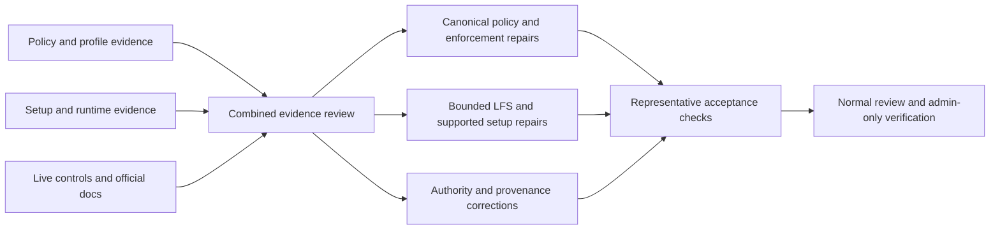

# Agent restrictions: evidence review and safe rollout

Audit date: 2026-10-22. Scope: repository instructions, agent profiles, setup,
LFS, memory/context handling, and the boundary between local preparation and
GitHub-controlled operations. Existing uncommitted PyPI work is preserved.

**Review decision:** remove contradictory preparation restrictions and unsupported
authority claims; retain secrets protection, least privilege, actual branch and
environment controls, and genuine execution approvals. Implementation follows the
reviewed sequence below. This report does not grant permissions.

## Evidence and inspection boundaries

Three independent lanes completed discovery before implementation:

| Owner | Coverage | Limits |
| --- | --- | --- |
| Policy Coach Agent | Nine scoped `AGENTS.md` files, two path-specific instruction files, core policies and enforcement; all 661 files under `.github/agents/` enumerated and programmatically scanned | Not every profile received full manual review; six selected prompts were only partially read |
| GitHub Guru Agent, runtime lane | Setup ordering, actual LFS commands, resource producers/consumers, context production, local application flags, and readiness checks | No authenticated LFS download or hosted-network observation |
| GitHub Guru Agent, platform lane | 58 scoped read-only GitHub observations and 19 timestamped official documentation snapshots | No settings changes or write probes; denied sources remain unknown |

The profile scan includes 335 Markdown files and 53 archived-tree files. There
are 126 frontmatter-bearing root Markdown candidates, not 126 confirmed active
profiles. The local registry/validator is a separate discovery mechanism.
Tool allowlists and model configuration may be meaningful when the host honors
them; they must not be indiscriminately widened.

The persistent [instruction/profile inventory](../docs/AGENT_INSTRUCTION_INVENTORY.md)
records manual versus automated coverage. Dependency-complete local validation
reports 224 passing and 15 failing records: twelve YAML schema mismatches, one
stale registry-summary record, and two filename-discovery mismatches. The broader
Markdown scan finds 125 schema-valid candidates plus one placeholder template.
These are distinct local formats, not proof of hosted activation. Successful
custom-agent invocation here proves available capabilities, not the provenance
of their hosted prompt bodies. Tool filters, model pins and execution approvers
were not widened to force catalog success.

No repository-root or ancestor `AGENTS.md` was found. `.github/AGENTS.md` is
directory-scoped, not a root instruction file. Archived instructions linked from
active guides are historical material, not automatically global policy.

Detailed discovery evidence is retained under the session artifact directory
`files/agent-restrictions/`: `INSTRUCTION_AUDIT.md`, `setup-runtime-evidence.md`,
`AUDIT.md`, `ENDPOINT_LEDGER.md`, `github-evidence.jsonl`, and
`official-docs-manifest.json`. The persistent
[sanitized evidence catalog](agent-restrictions-evidence-2026-10-22.json)
records all 58 endpoint/status observations, the 19 official sources, and
dependency-host transport checks without raw responses or credentials.
Quoted source positions below identify the
**pre-remediation audit snapshot**; remediation can move those lines.

## Verified platform observations

Observations ran from 05:27:43 through 05:29:44 UTC: 19 successful GETs, 35 HTTP
403 responses, and four HTTP 404 responses. These outcomes describe the session
credential, not the requesting user's permissions. Endpoint requirement headers
do not attest to the credential's granted permissions.

- The live default branch is `main`; the local checkout is `0D_base_`.
- Both branch lookups report `protected=true`. Accessible effective rules include
  deletion protection and automatic Copilot review. Automatic review is not a
  required human approval.
- Classic protection details are inaccessible. Required checks, human approval
  counts, CODEOWNERS enforcement, history restrictions, and administrator
  enforcement remain unknown. Disabled rulesets do not establish the absence of
  another effective control.
- Six environment objects were accessible. Two restrict deployment branches to
  `main`; none of the returned objects includes reviewer or wait-timer rules.
  This does not establish unrestricted deployment.
- Repository/organization Actions approval settings, classic branch protections,
  organization rulesets/security configuration, Agents secrets/variables, and
  hosted firewall/runner settings remain inaccessible or unverified.
- No write, push, rebase, approval, merge, deployment, workflow dispatch, or settings
  modification was attempted.

Current official documentation describes dedicated **Agents secrets and
variables**, including migration from the legacy Actions `copilot` environment.
That differs from the older location advice in the loaded customization guide.
Successful reads of a legacy environment object do not prove current credential
availability. Actual migration and Agents inventories were not accessible.

Instruction precedence is surface-specific. The documented nearest `AGENTS.md`
directory rule and applicable path/repository instructions must not be confused
with profile deduplication, token grants, or one universal cross-client ordering.

At 05:48:03 UTC, this session also retrieved public package metadata from
`pypi.org` and issued a HEAD request for the corresponding distribution on
`files.pythonhosted.org`; both returned HTTP 200 without downloading the
distribution. Together with the GitHub/documentation observations, this verifies
those current-session transports, not a hosted firewall configuration, every
dependency host, an authenticated LFS transfer, or future setup access.

## Blocker matrix

Classification separates executable repository checks from platform enforcement.
An existing workflow is not proof that its check is currently required or passing.

| ID | Severity | Source and pre-remediation lines | Classification / mechanism | Capability and reproducible scenario | Disposition |
| --- | --- | --- | --- | --- | --- |
| R01 | High | `.github/copilot-instructions.md:7-21`; `.codex/CODEBASE_AGENCY_POLICY.md:1472-1494` | Contradictory, capability-dependent instruction | Reading files requires tools, but the rule forbids any tool before reading; a store-only memory interface cannot retrieve all memories | Require relevant instruction/context review before affected edits; allow independent reads in parallel and disclose unavailable retrieval |
| R02 | High | Agency policy `1446-1455`; Copilot instructions `304-388`; `scripts/ci/check_deferral_language.py:102-112` | Advisory mandate plus CI-enforced wording | A direct lookup or explicit no-nested-agent boundary triggers agent-bypass wording violations | Delegate only genuinely independent work when suitable tools/specialists exist; preserve direct execution |
| R03 | High | Agency policy `213-264`; Copilot instructions `111-145`; scanner `58-112,501-544` | Contradictory and CI-enforced wording | A read-only audit or an honest bounded finding with owner/mitigation is rejected as deferral | Bound remediation to the objective and affected areas; retain security owner/reason requirements and truthful unresolved status |
| R04 | High | `.github/AGENTS.md:229-247`; Copilot instructions `290-296`; `.codex/SELF_HEALING_POLICY_TIERS.md:81-98`; `.github/WORKFLOW_GOVERNANCE.md:743-750` | Contradictory repository guidance | A requested workflow repair is simultaneously prohibited and permitted by review/risk rules; reading agent profiles is also banned | Permit authorized preparation and inspection; require appropriate review, actionlint and secret checks before publishing/executing sensitive changes |
| R05 | High | `.github/AGENTS.md:232`; agency policy `105-113`; `agent-auth-delegation.yml:676,819-911,1104` | Contradictory instructions plus freshness check | Rebase is both forbidden and required; mandatory synchronization risks dirty work | Preserve freshness/conflict checks; distinguish merge-base update, head rebase, and rebase-and-merge; no automatic rewrite of valuable dirty work |
| R06 | Medium | Agency policy `226,310-314,730-792,809-846,1243-1253,1289-1303`; `agent-auth-delegation.yml:733-758,781-818` | Advisory counts, overstated CI attestations | A small fix is required to repeat five reviews/attempts and emit a public continuation ping | Use risk-based review and sufficient evidence; require authorization for public comments/retriggers and give a clear status report |
| R07 | High | `.codex/AGENTIC_REPO_STATE.md:3-28,105-109`; `.codex/agent_context.json:22-30`; API reference `273-290` | Stale, unsupported authority claim | A true cached flag or checkbox/TTL is treated as admin authority over branches, merges, variables or deployment | Treat flags/provenance as application data; verify actual operation-specific access and preserve platform controls |
| R08 | High | Setup workflow `124-138,571-653`; `environment_preflight.py:151-185,255-280` | CI configuration ordering/capability blocker | Automatic setup skips dispatch-only fetches, then reports targeted mode after fetch steps have passed | Resolve narrow explicit asset intent before fetching; provide a task-invocable targeted path independent of dispatch |
| R09 | High | Setup workflow `590-607`; `tests/ci/test_setup_steps_guardrails.py:6-13` | Executable fail-open behavior | Commas become spaces; unsupported `checkout --include` fails; repeated failures still succeed through `|| true` | Shared bounded fetch/materialization helper, exact failure status, valid path handling, required-asset verification; no full-fetch fallback |
| R10 | High | Setup workflow `56-114,545-559`; `agent_resource_profile.py:156-210,239-278` | Unconsumed output / misleading capability claim | A sibling job recommends a runner but the setup job stays on fixed `ubuntu-latest` | Select the actual runner before its job starts; run resource probing inside setup and consume bounded repository-worker settings |
| R11 | High | Setup workflow jobs at `56,89,782`, timeout at `92`, top/job environment declarations | Platform setup contract versus ordinary Actions semantics | Sibling rescue/resource jobs and unsupported job settings are assumed to configure automatic bootstrap | Conform to one named setup job and supported customization; explicit step inputs/environment; retain maximum 59-minute timeout |
| R12 | High | Setup workflow `163-187`; `kernel.py:63-68,158-188,369-391`; `session_preload.py:161-207` | Application flags misrepresented as platform controls | A false repository flag aborts unrelated setup even though it cannot pin GitHub runtime or intercept upstream payloads | Preserve useful local evolution behavior, but remove unrelated bootstrap hard gates and correct descriptions/validators |
| R13 | Medium | Setup workflow `194-199,267-327`; `pattern_scorer.py:424-469`; `autonomous_rag_context.py:638-686,849-867,983-989` | Capability-dependent context production, broken consumers | Unsupported scorer flags or missing facade methods prevent context; logs/files are nevertheless described as prompt injection | Repair actual supported calls where bounded; distinguish generated/readable artifacts from confirmed host attachment; explicit optional/required status |
| R14 | High | Setup workflow `663-664,758-773`; `environment_preflight.py:132-148`; setup shell validator `79-87` | Executable information/readiness overclaim | Broad prefixed environment output risks credential exposure; import-spec presence and unrelated runner text produce false readiness | Safe allowlists, scoped checks of actual consumers, and truthful partial-environment/required-asset status |
| R15 | Medium | `.github/agents/owner-approval-guard.agent.md:15`; registry `1445-1456,1986-1993`; local profile validator | Stale/contradictory catalog versus capability-dependent profile configuration | Deprecated body/catalog labels disagree; local filename discovery differs from candidate profiles | Record distinct inventories and reconcile narrowly; do not claim host activation or remove meaningful tool filters/model pins |
| R16 | Medium | `session_wrapup_autofix.py:1105-1146,1180-1219`; `workflow-execution-gate.yml:83-100`; claimed absent `comment-review-gate.yml` | Text attestation / overstated enforcement | Named agents, a WEC selection, or a zero-exit placeholder are treated as actual execution or approval | Support honest direct/no-PR records; distinguish selection, invocation evidence, check conclusion and required protection |

## Memory and context inventory

| Source | Scope / provenance | Freshness and retrievability | Required handling |
| --- | --- | --- | --- |
| Supplied repository memories | 20 session-provided entries with repository citations | Snapshot available; creation/verification timestamps unspecified | Verify relevant claims against current cited code; duplicate generated-artifact entries and context-dependent import claims are not universal policy |
| Supplied user memories | Five historical workflow preferences with user quotations | Supplied snapshot available; dates unspecified | Apply only relevant stated scope; historical credential-use approval does not create current GitHub permissions |
| Additional Copilot memory service records | Host-managed user/repository scopes | No arbitrary list/get/search retrieval interface in this session; storage/voting is not retrieval | Record unavailable sources; do not simulate loading through a write or require exhaustive retrieval |
| `.codex/agent_context.json` | Tracked repository configuration snapshot | Generated 2026-07-13; checkout mtime 2026-10-22 is not synchronization proof | Do not overwrite historical values or use flags to infer current auth/firewall/runtime settings |
| `.codex/AGENTIC_REPO_STATE.md` | Repository prose linked as startup context | Previously verified 2026-05-24; locally readable | Replace unsupported authority assertions with the actual verification boundary |
| PDA history, startup/context artifacts and session checkpoints | Repository history or host-provided continuity artifacts | File-specific timestamps; delivery/attachment depends on actual consumer | Read relevant bounded material, retain provenance, and distinguish generation from prompt attachment |
| Organization/user/host settings and unsupplied records | External managed sources | Not fully retrievable with current interfaces/credential | Explicitly unknown, not silently treated as audited or absent |

Memories are context, not authoritative instructions. Ignore or flag stale,
conflicting, inaccessible and irrelevant entries; do not delete unrelated valid
preferences merely because this task does not use them. Never store secrets or
personal data. Storage requires a suitable available interface and a clear
user/repository scope. One misleading resource-runner memory was downvoted after
checking its actual producer/consumer trace.

## Canonical sources and duplicates

- `.codex/CODEBASE_AGENCY_POLICY.md`: canonical objective, capability, review,
  delegation and truthful-status contract.
- `.github/copilot-instructions.md`: concise repository-wide entry point.
  `.github/AGENTS.md` and path-scoped instructions retain their real local scope.
- `.github/WORKFLOW_GOVERNANCE.md`: workflow validation, secrets and review;
  self-healing tiers govern their execution subsystem, not every local edit.
- Setup workflow plus resource/LFS/context helpers: executable capability
  preparation, not a source of platform authorization.
- API references and the agency-state document: verifiable credential and
  snapshot boundaries; historical values remain historical.
- Agent planning guides and affected profile bodies: references to the canonical
  contract, not independent contradictory global mandates.
- Archived policy copies and mutant trees remain historical. Active links must
  not silently import them as current global instructions.

## Reviewed rollout sequence



1. Correct the canonical policy and active duplicates together. Replace circular
   startup, compulsory delegation, unlimited scope, arbitrary iteration counts
   and mandatory public follow-up prompts. Preserve meaningful security and
   execution-approval contracts.
2. Coordinate actual wording checks and direct/no-PR attestations with their
   tests. Do not merely append a permissive banner over contradictory rules.
3. Repair setup structure/order and required targeted LFS access. Full-repository
   LFS remains explicit opt-in. Bound intended objects/bytes/time; verify assets;
   fail clearly without a broad download fallback.
4. Correct resource, local-flag, context-delivery and readiness claims. Keep
   required failures explicit and optional capabilities transparent.
5. Validate representative tasks and changed workflow/code surfaces in isolation.
   No test result is a substitute for GitHub authorization or hosted deployment.
6. Submit through normal review if publication is requested. Actual branch,
   organization, environment, firewall and runner-setting changes are admin
   actions, not implied by this audit or repository prose.

## Representative acceptance scenarios

| Scenario | Least-restrictive safe outcome | Acceptance evidence |
| --- | --- | --- |
| Ordinary code fix, no specialist | Direct scoped edit and relevant checks permitted | Canonical policy and wording-check regressions |
| Requested workflow creation/edit | Preparation allowed; actionlint, secret checks, appropriate review and actual write access still required | Workflow policy consistency and syntax/secret checks; no execution permission inferred |
| LFS-backed ML/data task | Explicit narrow paths available without dispatch-only dependence; budget checked before fetch | Real local LFS fixture plus absent-object, unresolved-pointer, budget and timeout tests |
| Full LFS request | Only explicit opt-in; never a targeted-fetch fallback | Workflow/helper negative tests |
| Network-dependent install | Use required permitted hosts; report denied access or missing dependency explicitly | Capability/failure handling tests; no firewall-disable workaround |
| Memory unavailable or conflicting | Use relevant supplied context; continue ordinary work and state the gap | Policy/preload tests; no storage-as-retrieval or authority promotion |
| Dependent agent tasks | Sequence dependencies; parallelize only independent work when tools are available | Direct/delegated reporting cases; no fabricated dispatch attestation |
| PR and no-PR work | Preserve WEC state for an existing PR; local preparation does not require inventing a PR | Explicit direct/no-PR helper cases and status report |

## Administrator-only verification and rollout

An authorized administrator or delegated settings owner must verify the denied
classic protection/Actions settings, applicable organization rules and bypass
actors, dedicated Agents inventories/migration, runner entitlement/labels, hosted
Internet-access rules/locks, and intended deployment protection. Review the
disabled rulesets without assuming they should be enabled. Do not widen tokens,
disable firewalls, change protections, distribute secrets, or modify settings as
an automatic remediation.

The setup file must reach the default branch through normal review before its
automatic-bootstrap behavior can be observed. Local syntax/unit/integration tests
cannot establish that deployment, an authenticated GitHub LFS transfer, or a hosted
firewall outcome. These are explicitly separate verification steps. Repository
edits also do not retroactively change an existing session's host-supplied
instructions, tool exposure, credentials or permissions.

## Official references

Current evidence uses GitHub's environment, Agents secrets/variables, custom
instruction support/precedence, custom-agent configuration, risks/mitigations,
ruleset and REST update-branch documentation. The timestamped source manifest is
retained with the session evidence.

- https://docs.github.com/en/copilot/how-tos/copilot-on-github/customize-copilot/customize-cloud-agent/customize-the-agent-environment
- https://docs.github.com/en/copilot/how-tos/copilot-on-github/customize-copilot/customize-cloud-agent/configure-secrets-and-variables
- https://docs.github.com/en/copilot/concepts/prompting-and-context/custom-instructions#precedence-of-custom-instructions
- https://docs.github.com/en/copilot/reference/custom-instructions-support
- https://docs.github.com/en/copilot/reference/custom-agents-configuration
- https://docs.github.com/en/copilot/concepts/security-governance-and-network-settings/risks-and-mitigations
- https://docs.github.com/en/rest/pulls/pulls#update-a-pull-request-branch

## Implementation and validation status

Evidence review preceded the coordinated changes. The policy lane repaired 37
owned files; the runtime lane repaired 20, including six new helpers/tests.
The parent corrected five authority/API references and persisted the combined
audit, sanitized evidence, changelog and accountability records.

| Finding group | Applied disposition |
| --- | --- |
| R01-R06 | Canonical and affected active duplicates now permit relevant inspection, scoped direct work, capability-aware memory/delegation, authorized workflow preparation and risk-based review. Wording-only diagnostics are advisory; actual input errors and security owner/reason checks remain blocking. Freshness does not mandate rewriting dirty work. |
| R07 | Historical snapshots, feature flags, checkboxes and TTL records no longer claim platform administration or protected-operation approval. Dedicated Agents stores are distinguished from ordinary Actions stores. |
| R08-R09 | `scripts/ci/fetch_lfs_assets.py` is callable during a task without dispatch. Setup resolves explicit paths before fetching. Required failures are nonzero; selected content is checked by path, size and SHA-256; no broad fallback exists. |
| R10-R12 | Setup has one supported job, 59-minute timeout and contents-read permission. `runs-on` selects the runner before steps. In-job resource outputs tune actual repository/build consumers, not GitHub's scheduler. Local evolution flags do not block unrelated bootstrap or purport to configure GitHub's runtime. |
| R13-R14 | Optional bounded context production uses supported scorer calls and reports unavailable RAG explicitly; no implicit index/model provisioning or prompt attachment is claimed. Diagnostics are allowlisted and readiness distinguishes required failures from optional gaps. |
| R15 | Programmatic/manual inventories and remaining local schema/discovery mismatches are recorded separately. Profile frontmatter, tool filters/model pins and execution approvers are preserved. Catalog metadata does not prove hosted loading. |
| R16 | Wrapup supports honest direct/no-PR records, rejects contradictory/fabricated utilization and preserves existing PR selections. Workflow selection, actual execution, conclusion and approval remain distinct. |

Targeted LFS defaults are 32 paths/objects, 256 MiB declared unique-object bytes,
180 seconds total, two attempts and two transfers. Timeout overrides are capped
at 600 seconds and attempts at three. These are expected-object/resource limits,
not server-enforced quota or bandwidth guarantees. Explicit full mode intentionally
covers current-HEAD assets only; historical `--all` behavior was removed rather
than retained as a hidden cost escalation.

### Acceptance evidence

The detached integration worktree overlays all existing PyPI changes and both
restriction lanes. Normal repository pytest configuration ran this command
using `/tmp/pypi-venv/bin/python`:

```bash
python -m pytest -q \
  tests/agents/test_validate_agent_specs.py \
  tests/scripts/test_ci_top5.py \
  tests/ci/test_session_wrapup_autofix.py \
  tests/ci/test_agent_instruction_contract.py \
  tests/ci/test_fetch_lfs_assets.py \
  tests/ci/test_agent_bootstrap_runtime.py \
  tests/ci/test_agent_resource_profile.py \
  tests/ci/test_environment_preflight.py \
  tests/ci/test_setup_steps_guardrails.py \
  tests/ci/test_concurrent_executor_limit.py \
  tests/scripts/test_session_preload.py \
  tests/scripts/test_ci_script_regressions.py \
  tests/integration/test_phase_10_3_injection.py \
  --junitxml=../combined-acceptance.xml
```

Result: **219 passed; zero failures, errors or skips**. This includes real local
Git LFS 3.4.1 standalone transfers, spaces/multiple patterns, unrequested-pointer
preservation, missing/mismatched content, pre-fetch budgets, retry/no-fallback and
timeout cases, direct/no-PR records and the actual security owner/reason guards.

| Additional check | Result |
| --- | --- |
| Pinned `go run github.com/rhysd/actionlint/cmd/actionlint@v1.7.7` on the three changed workflows | Passed |
| `python scripts/ci/validate_copilot_setup_steps.py --check-only` | 13/13 passed |
| `python scripts/ci/validate_copilot_dependencies.py` | 4/4 passed |
| `bash -n` on seven setup run blocks and the shell validator | Passed |
| Mypy with `--follow-imports=skip --ignore-missing-imports --explicit-package-bases` on all 16 changed source modules | Passed; not repository-wide typing |
| `black --check` on all seven new Python files | Passed; final policy-test formatting was AST-equivalent |
| Configured `pre-commit run --files` on all 67 audited/remediated paths | Passed; includes yamllint, schema, secret, link, profile-size and source checks |
| Historical `agent_context.json` diff | Unchanged |

Detailed commands and outputs remain in `files/agent-restrictions/`, including
the two implementation handoffs, `combined-acceptance.xml`, its log and the
policy/runtime scoped check records. `final-hook-paths.json` records the exact
67-path selection and `final-pre-commit.log` the configured-hook outcomes.
Informational mypy/pydocstyle hooks are not treated as repository-wide success;
the separate 16-source mypy command above provides the scoped typing result.
Four existing hook-stage deprecation warnings remain warnings, not ignored
validation failures.

No PR body, WEC selection or remote state was changed for this local preparation.
No workflow was created, activated or dispatched; the existing setup changes need
normal review into the default branch before hosted observation. Actual hosted
setup, authenticated GitHub LFS, administrative settings, a clean global catalog
and broader package-readiness gates are not claimed.
