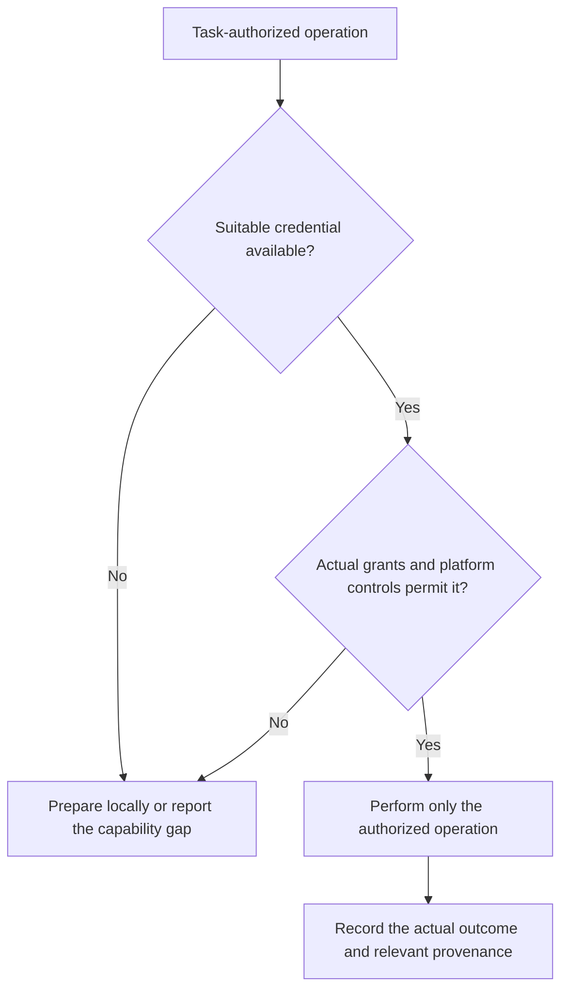

# GitHub API Reference for Copilot Coding agent
**Last Updated:** 2026-10-22
**Version:** v0.3.0

> **Scope:** Aries-Serpent/_codex_ repository
> **Audience:** GitHub Copilot Coding agent (Web UI)
> **Authority boundary:** Repository guidance is not a GitHub permission grant.
> **Last Updated:** 2026-10-22
> **Full Secrets/Variables Reference:** [`docs/reference/GITHUB_VARIABLES_SECRETS_REFERENCE.md`](../reference/GITHUB_VARIABLES_SECRETS_REFERENCE.md)
> **CB Knowledge Entry:** [`.codex/docs/GITHUB_API_AND_MCP_REFERENCE.md`](../../.codex/docs/GITHUB_API_AND_MCP_REFERENCE.md)
> **Policy:** `.codex/CODEBASE_AGENCY_POLICY.md` §0–§4

---

## TOKEN HIERARCHY — WHICH TOKEN TO USE WHEN

Use an available credential with the smallest permission set suitable for the
operation. Report HTTP permission failures explicitly. Repository fallback
preferences do not establish scope, validity, role, or bypass eligibility:

| Priority | Token / Secret | Scopes | When to Use |
|----------|---------------|--------|-------------|
| Preferred configured fallback | `secrets.CODEX_MASTER_KEY` | Verify actual token type and grants | Only authorized operations requiring its grants |
| Backup configured fallback | `secrets.CODEX_BACKUP_KEY` | Verify independently; do not assume identical grants | Appropriate authorized fallback |
| Optional App integration | `secrets._GITHUB_APP_PRIVATE_KEY` + `_GITHUB_APP_ID` | Actual installation permissions and repository selection | Authorized Cognitive Brain App operations |
| Job-local token | `github.token` / `secrets.GITHUB_TOKEN` | Actual job permissions and platform eligibility | Available operations within that workflow job |

Classic PAT scopes such as `repo`/`workflow` and fine-grained permissions such as
Actions write are different authorization models. Protected operations depend on
actual credentials and controls, never the credential's name. A workflow's
`GITHUB_TOKEN` is not Copilot's separate operating token; neither implies
unrestricted protected-branch or administrative access.

### Secret availability and agent boundaries

Organization Copilot policy settings (including organization-locked automation and
validation settings) do not prove that a workflow secret is organization-scoped, currently
valid, or available to every Copilot/custom agent. A secret is available only to eligible
workflow jobs and steps that reference it; `GITHUB_TOKEN` is separately scoped by that
job's `permissions`. Copilot agent processes, delegated agents, and read-only MCP tools
must not be assumed to inherit either credential. The Agent Token Delegation workflow
checks whether the configured `CODEX_MASTER_KEY`/`CODEX_BACKUP_KEY` credential can read
the repository and reports only the result, never the token value. This proves only
credential availability and repository-read access in that job, not organization scope,
write/administrative permissions, or universal agent access; activation stops if a
configured CODEX credential fails this read check. Do not expose a privileged
organization token to every agent; use the smallest permission set and short-lived
credentials needed by each workflow.

Current GitHub documentation uses dedicated [Agents secrets and variables](https://docs.github.com/en/copilot/how-tos/copilot-on-github/customize-copilot/customize-cloud-agent/configure-secrets-and-variables),
including migration from the legacy Actions `copilot` environment. Ordinary
Actions, Codespaces and Dependabot stores are not automatically cloud-agent
credentials. The actual Agents inventories were inaccessible during the
2026-10-22 read-only audit; no migration or universal inheritance is assumed.

### Existing Workflow Fallback Pattern
```yaml
env:
 GH_TOKEN: ${{ secrets.CODEX_MASTER_KEY || secrets.CODEX_BACKUP_KEY || github.token }}
```

---

## REPOSITORY VARIABLES — READ/WRITE REFERENCE

These variables are the Cognitive Brain's persistent state. Read them to understand
current session context; write them to record outcomes.

| Variable | Type | Purpose | Write Method |
|----------|------|---------|--------------|
| `COPILOT_AGENT_AUTH_ENABLED` | `vars.*` | Repository feature gate, not proof of an active credential | `gh api -X PATCH /repos/{owner}/{repo}/actions/variables/COPILOT_AGENT_AUTH_ENABLED` |
| `COPILOT_AGENT_STATE` | `vars.*` | `ACTIVE` / `IDLE` / `SUSPENDED` | Same pattern |
| `COPILOT_AGENT_SESSION_EXPIRES` | `vars.*` | ISO-8601 TTL for current session | Same pattern |
| `COPILOT_AGENT_LAST_SESSION_ID` | `vars.*` | Last session UUID | Same pattern |
| `COGNITIVE_BRAIN_SESSION_NUMBER` | `vars.*` | Monotonic session counter (S240, S241…) | Increment via API |
| `CODEX_CI_FAILURE_RATE` | `vars.*` | Current CI failure rate (0–100) | Written by ci-health-alert-agent |
| `CODEX_CI_LAST_GREEN_SHA` | `vars.*` | Last commit SHA where all CI passed | Written by copilot-agent-session-done |
| `CODEX_GROUNDED_TIER` | `vars.*` | `E` / `D_CAPABLE` / `D` — agent autonomy level | Written by promotion gate |
| `COGNITIVE_BRAIN_ALLOWED_ACTORS` | `vars.*` | Comma-separated list of authorised actors | Written by agent-auth-delegation |
| `CODEX_COVERAGE_THRESHOLD` | `vars.*` | Minimum required test coverage % (default: 95) | Manual / admin only |

### Read a Variable (gh CLI)
```bash
gh api -X GET /repos/Aries-Serpent/_codex_/actions/variables/COPILOT_AGENT_AUTH_ENABLED \
 --jq '.value'
```

### Write a Variable (gh CLI)
```bash
gh api -X PATCH /repos/Aries-Serpent/_codex_/actions/variables/COPILOT_AGENT_STATE \
 -f name='COPILOT_AGENT_STATE' \
 -f value='ACTIVE'
```

### Increment a Counter Variable (shell pattern used in agent-auth-delegation.yml)
```bash
CURRENT=$(gh api /repos/$REPO/actions/variables/COGNITIVE_BRAIN_SESSION_NUMBER --jq '.value // "0"')
NEXT=$((CURRENT + 1))
gh api -X PATCH /repos/$REPO/actions/variables/COGNITIVE_BRAIN_SESSION_NUMBER \
 -f name='COGNITIVE_BRAIN_SESSION_NUMBER' \
 -f value="$NEXT"
```

---

## PR BODY — WEC READ/WRITE PROTOCOL

The Workflow Execution Checklist (WEC) lives in the PR body. The agent MUST read
it before every write to preserve maintainer checkbox state.

### Step 1 — Read current PR body
```bash
BODY=$(gh pr view "${PR_NUMBER}" \
 --repo "Aries-Serpent/_codex_" \
 --json body \
 --jq '.body // ""')
```

### Step 2 — Extract WEC checkbox state (Python — session_wrapup_autofix.py pattern)
```python
import sys
sys.path.insert(0, "scripts/ci")
import session_wrapup_autofix as swa

body = open_pr_body() # from gh pr view
existing_state = swa._extract_wec_state(body)
# Returns: {"pre-merge-validation.yml": True, "resilient_validation.yml": False, ...}
```

## Step 3 — Rebuild canonical WEC preserving maintainer selections
```python
new_wec_block = swa._build_wec_block(existing_state=existing_state)
```

### Step 4 — Strip old WEC, append new canonical block
```bash
STRIPPED=$(printf '%s' "$BODY" \
 | sed '/^## Workflow Execution Checklist/,$d' \
 | sed '/^\*\* Workflow Execution Checklist\*\*:/,$d')

UPDATED="${STRIPPED}${NEW_WEC_BLOCK}"

gh pr edit "${PR_NUMBER}" \
 --repo "Aries-Serpent/_codex_" \
 --body "${UPDATED}"
```

### Step 5 — report_progress MUST include WEC
Every `report_progress` call must include the full canonical WEC block in
`prDescription`. **Never** reconstruct from template; always copy from live PR body.

```python
# CORRECT — copy live state
existing_state = swa._extract_wec_state(live_pr_body)
wec = swa._build_wec_block(existing_state=existing_state)
report_progress(prDescription=f"{checklist}\n{wec}")

# WRONG — reconstructing from template loses maintainer [x] selections
report_progress(prDescription=checklist_only)
```

> **HARDENED RULE:** Never reset a `[x]` item to `[ ]`. Never omit the WEC block.
> `deferral-language-gate.yml`, `pre-merge-validation.yml`, `comment-review-gate.yml`,
> `agent-auth-delegation.yml`, `workflow-execution-gate.yml`, all Always-Active items
> MUST always be `[x]`.

---

## POSTING COMMENTS — PATTERNS

### Post a plain comment to PR
```bash
gh pr comment "${PR_NUMBER}" \
 --repo "Aries-Serpent/_codex_" \
 --body "$(cat comment.md)"
```

### Post using GitHub REST API (octokit/github-script)
```javascript
await github.rest.issues.createComment({
 owner: context.repo.owner,
 repo: context.repo.repo,
 issue_number: prNumber,
 body: commentBody,
});
```

### Update an existing comment (avoid duplicate rescue comments)
```javascript
// List existing comments
const comments = await github.rest.issues.listComments({
 owner, repo, issue_number: prNumber, per_page: 100
});
const existing = comments.data.find(c =>
 c.body.includes('<!-- rescue-comment-marker -->')
);
if (existing) {
 await github.rest.issues.updateComment({
 owner, repo, comment_id: existing.id, body: newBody
 });
} else {
 await github.rest.issues.createComment({
 owner, repo, issue_number: prNumber, body: newBody
 });
}
```

### React to a comment (acknowledge maintainer feedback)
```javascript
await github.rest.reactions.createForIssueComment({
 owner, repo,
 comment_id: commentId,
 content: 'rocket', // +1 | -1 | laugh | confused | heart | hooray | rocket | eyes
});
```

---

## WORKFLOW RUNS — APPROVE / CANCEL / TRIGGER

### List pending (action_required) runs for a SHA
```bash
gh api \
 "/repos/Aries-Serpent/_codex_/actions/runs?head_sha=${HEAD_SHA}&status=action_required" \
 --jq '.workflow_runs[] | {id, name, status, conclusion}'
```

### Approve a pending run (requires `actions:write` — use CODEX_MASTER_KEY)
```javascript
// github-script
await github.rest.actions.approveWorkflowRun({
 owner: 'Aries-Serpent',
 repo: '_codex_',
 run_id: runId,
});
```

```bash
# gh CLI equivalent
GH_TOKEN="${CODEX_MASTER_KEY}" \
 gh api -X POST "/repos/Aries-Serpent/_codex_/actions/runs/${RUN_ID}/approve"
```

## Cancel a run
```bash
gh api -X POST "/repos/Aries-Serpent/_codex_/actions/runs/${RUN_ID}/cancel"
```

### Trigger a workflow manually (workflow_dispatch)
```bash
gh workflow run validate.yml \
 --repo "Aries-Serpent/_codex_" \
 --ref "copilot/s240-health-sweep" \
 --field pr_number="3873"
```

```javascript
await github.rest.actions.createWorkflowDispatch({
 owner, repo,
 workflow_id: 'validate.yml',
 ref: 'copilot/s240-health-sweep',
 inputs: { pr_number: '3873' },
});
```

### Re-run a failed workflow
```bash
gh run rerun "${RUN_ID}" --repo "Aries-Serpent/_codex_" --failed
```

### List all runs for a branch + filter by status
```bash
gh api \
 "/repos/Aries-Serpent/_codex_/actions/runs?branch=copilot/s240-health-sweep&per_page=50" \
 --jq '.workflow_runs[] | select(.conclusion=="failure") | {id,name,conclusion}'
```

---

## REPOSITORY DELEGATION PROVENANCE — NOT PLATFORM AUTHORITY

The `agent-auth-delegation.yml` workflow records repository-local provenance and
checks configured automation conditions. A checkbox, TTL, feature flag, or local
file cannot grant GitHub-issued privileges or bypass owner, branch, environment,
organization, or platform controls. Verify the current workflow implementation
rather than treating historical checkbox instructions as the current trigger.

### Operation-specific authorization boundary



### Session Token File (`.codex/agent_auth_session.json`)
```json
{
 "session_id": "<uuid>",
 "issued_at": "2026-04-05T11:22:00Z",
 "issued_by": "agent-auth-delegation",
 "expires_at": "2026-04-05T23:22:00Z",
 "pr_number": 3873,
 "note": "Repository provenance only; not a GitHub credential or an owner-approval bypass."
}
```

### Inspecting local provenance when relevant
```python
import json
from pathlib import Path
from datetime import datetime, timezone

session_file = Path(".codex/agent_auth_session.json")
if session_file.exists():
 session = json.loads(session_file.read_text())
 expires = datetime.fromisoformat(session["expires_at"])
 if datetime.now(timezone.utc) < expires:
 print(f" Local provenance record unexpired until {expires.isoformat()}")
 else:
 print(" Local provenance record expired; check the relevant integration contract")
else:
 print(" No local provenance record; inspect the relevant repository workflow if needed")
```

### Optional Integration Credentials

These names describe configured integrations, not a required credential bundle
for ordinary work or a guarantee of maintainer-equivalent access. Never distribute
them broadly to compensate for an unavailable capability.

| Secret | Purpose |
|--------|---------|
| `CODEX_MASTER_KEY` | Configured credential; verify token type, grants and eligibility |
| `CODEX_BACKUP_KEY` | Independently verified fallback credential |
| `_GITHUB_APP_ID` | Cognitive Brain App ID (GitHub App) |
| `_GITHUB_APP_PRIVATE_KEY` | Cognitive Brain App private key (PEM) |
| `_GITHUB_APP_INSTALLATION_ID` | Installation ID for this repo |

### Generating a GitHub App Installation Token (Cognitive Brain App)
```python
import jwt, time, requests

# 1. Create JWT signed with App private key (10-min TTL)
payload = {
 "iat": int(time.time()) - 60,
 "exp": int(time.time()) + (10 * 60),
 "iss": APP_ID,
}
app_jwt = jwt.encode(payload, PRIVATE_KEY, algorithm="RS256")

# 2. Exchange for installation token
resp = requests.post(
 f"https://api.github.com/app/installations/{INSTALLATION_ID}/access_tokens",
 headers={
 "Authorization": f"Bearer {app_jwt}",
 "Accept": "application/vnd.github+json",
 },
)
installation_token = resp.json()["token"]
# installation_token has same scopes as App installation permissions
```

## GitHub Actions — Generate App Token (reusable pattern)
```yaml
- name: Generate Cognitive Brain App token
 id: app-token
 uses: actions/create-github-app-token@v1
 with:
 app-id: ${{ secrets._GITHUB_APP_ID }}
 private-key: ${{ secrets._GITHUB_APP_PRIVATE_KEY }}

- name: Use App token
 env:
 GH_TOKEN: ${{ steps.app-token.outputs.token }}
 run: gh pr edit "$PR_NUMBER" --body "$NEW_BODY"
```

---

## DEFERRAL LANGUAGE GATE — WHAT TRIGGERS IT

`scripts/ci/check_deferral_language.py` scans every PR body, commit message, and
comment for forbidden phrases. CI fails on any match **not covered by an exemption**.

### Forbidden Trigger Phrases (any variation)
```
"pre-existing issue / pre-existing code"
"not from our current feature/branch/PR"
"out of scope / outside the scope"
"will address in a future PR/task/session"
"future PR / follow-up PR"
"not my responsibility / not my problem"
"can be addressed later / will fix later"
"address incrementally / address separately"
"another session/agent should handle"
"can be deferred / should be deferred"
```

### Valid Exemptions (will NOT trigger)
```python
EXEMPTION_PATTERNS = [
 r"\d+\s+pre-existing\s+(?:type\s+)?errors\b", # "104 pre-existing errors" (mypy baseline)
 r"pre-existing\s+test", # "pre-existing test infrastructure"
]
```

### Self-Check Before Committing
```bash
python scripts/ci/check_deferral_language.py \
 --pr-body "$(gh pr view $PR_NUMBER --json body --jq '.body')" \
 --commit-messages "$(git log --format='%s' HEAD~5..HEAD)"
```

---

## PR COMMENT REVIEW GATE — BLOCKING COMMENT DETECTION

`comment-review-gate.yml` scans PR review comments and inline comments for
**unresolved blocking items** before allowing merge.

### How the Gate Works
1. Lists all review threads via `github.rest.pulls.listReviewComments`
2. Filters for threads containing keywords: `MUST`, `REQUIRED`, `BLOCKING`, ``, ``
3. Checks if each flagged thread is `resolved: true`
4. Fails CI if any blocking thread is unresolved

### Manually Resolve a Review Thread
```javascript
await github.rest.pulls.resolveReviewThread({
 owner, repo,
 pull_number: prNumber,
 thread_id: threadId,
});
```

### Check for Open Review Threads (gh CLI)
```bash
gh pr view "$PR_NUMBER" \
 --repo "Aries-Serpent/_codex_" \
 --json reviewThreads \
 --jq '.reviewThreads[] | select(.isResolved == false) | {id, isResolved, comments: [.comments[].body[:80]]}'
```

---

## CI STATUS — CHECKING AND REACTING

### Get all check runs for a commit SHA
```bash
gh api \
 "/repos/Aries-Serpent/_codex_/commits/${SHA}/check-runs?per_page=100" \
 --jq '.check_runs[] | {name, status, conclusion}'
```

### Get combined commit status
```bash
gh api \
 "/repos/Aries-Serpent/_codex_/commits/${SHA}/status" \
 --jq '{state, statuses: [.statuses[] | {context, state, description}]}'
```

### List workflow runs for PR branch (most recent first)
```bash
gh api \
 "/repos/Aries-Serpent/_codex_/actions/runs?branch=${BRANCH}&per_page=30" \
 --jq '.workflow_runs[] | {id, name, status, conclusion, created_at}' \
 | head -50
```

### Get job logs for a failed run
```bash
# List jobs in a run
gh api "/repos/Aries-Serpent/_codex_/actions/runs/${RUN_ID}/jobs" \
 --jq '.jobs[] | select(.conclusion=="failure") | {id, name}'

# Download logs for a specific job
gh api "/repos/Aries-Serpent/_codex_/actions/jobs/${JOB_ID}/logs" > job.log
```

---

## COGNITIVE BRAIN CONNECTED APP — API SURFACE

The Cognitive Brain app exposes a FastAPI server (default: `http://localhost:8765`
or `$CODEX_CLI_API_URL` / `$COGNITIVE_APP_API_URL`).

### Session Context Injection (read at session start)
```python
import httpx

base_url = os.environ.get("COGNITIVE_APP_API_URL", "http://localhost:8765")

# GET /api/v1/session/context — returns recency-ranked patterns + stored memories
resp = httpx.get(f"{base_url}/api/v1/session/context", timeout=10)
ctx = resp.json()
# ctx["patterns"] — top-N CI patterns from LTM
# ctx["memories"] — recent store_memory facts
# ctx["session_number"] — current COGNITIVE_BRAIN_SESSION_NUMBER
```

## AfterMath / PDA Loop Close (call at session end)
```python
# POST /api/v1/session/complete — records outcome, updates LTM
httpx.post(f"{base_url}/api/v1/session/complete", json={
 "session_id": session_id,
 "pr_number": 3873,
 "commits_pushed": ["2b53d0f"],
 "ci_fixes": ["secrets.baseline", "WEC filenames", "RAG coverage"],
 "files_changed": 12,
 "outcome": "success",
})
```

## Memory Read/Write (SQLiteMemory)
```python
# GET /api/v1/memory?query=WEC&tier=LTM&limit=5
resp = httpx.get(f"{base_url}/api/v1/memory",
 params={"query": "WEC", "tier": "LTM", "limit": 5})

# POST /api/v1/memory — store new fact
httpx.post(f"{base_url}/api/v1/memory", json={
 "subject": "WEC filenames",
 "fact": "resilient_validation.yml (underscore) NOT resilient-validation-suite.yml",
 "citations": "scripts/ci/session_wrapup_autofix.py _WEC_ITEMS",
 "tier": "LTM",
})
```

## CI Pattern Feed
```python
# POST /api/v1/patterns/record — add CI failure pattern
httpx.post(f"{base_url}/api/v1/patterns/record", json={
 "pattern_id": "RP-WEC-FILENAME-DRIFT",
 "description": "WEC items use wrong filenames; WEC gate never matches opt-in checkboxes",
 "fix": "Update _WEC_ITEMS to match actual .github/workflows/*.yml filenames",
 "confidence": 0.98,
 "recurrence": 4,
})
```

---

## CODEBASE-WIDE CHANGES — SAFE PATTERNS

### Pattern: Find-and-replace across all workflow files
```bash
# Dry-run first
grep -rn "resilient-validation-suite" .github/workflows/ --include="*.yml"

# Apply with sed
find .github/workflows/ -name "*.yml" -exec \
 sed -i 's/resilient-validation-suite\.yml/resilient_validation.yml/g' {} +
```

## Pattern: Atomic multi-file Python edit via AST
```python
import ast, pathlib

for pyfile in pathlib.Path("src/").rglob("*.py"):
 src = pyfile.read_text()
 if "target_pattern" in src:
 new_src = src.replace("target_pattern", "replacement")
 pyfile.write_text(new_src)
```

### Pattern: Validate no regressions after codebase-wide change
```bash
# 1. Lint
python -m ruff check src/ tests/ scripts/

# 2. Type-check (against baseline — don't introduce new errors)
python scripts/ci/mypy_baseline.py --check

# 3. Tests relevant to changed modules
python -m pytest tests/ -k "wec or rag or session" -q

# 4. detect-secrets (no new false positives)
detect-secrets scan --baseline .secrets.baseline

# 5. Deferral language gate
python scripts/ci/check_deferral_language.py --pr-body "$(gh pr view $PR --json body -q .body)"
```

## Pattern: Publish through the available authorized mechanism

Use `report_progress` when the host provides and requires it. Otherwise use the
available authorized repository tooling; do not invent an unavailable function.
Preparing local changes is separate from permission to push, run privileged
workflows, merge, deploy, or change settings. Preserve existing PR/WEC state when
a PR exists; local work does not require inventing one.

```python
# Only when this tool is exposed by the host:
report_progress(
 commitMessage="fix: <description>",
 prDescription=f"{checklist}\n{canonical_wec_block}",
)
```

---

## PRE-CONCLUSION CHECKLIST (§0 CODEBASE_AGENCY_POLICY.md)

Before concluding, report the checks relevant to the objective and affected
areas, their actual results, and any unresolved or unavailable evidence. Apply PR
checks only when a PR exists, and do not claim that a check ran from a selection
or text attestation.

```
 Applicable PR feedback and affected CI findings reviewed
 Task-relevant fixes validated; other findings and limitations recorded honestly
 Existing WEC selections preserved when updating an existing PR
 Required changelog/accountability records updated in their active locations
 Any changed manifest/baseline integrity contract preserved
 Relevant tests and security checks reported with their real outcomes
 Optional local session services used only when available and applicable
```

---

## CANONICAL WEC BLOCK (copy verbatim into every report_progress)

```markdown
---

## Workflow Execution Checklist

### Always Required — fire automatically on every push (cannot be skipped)
- [x] pre-merge-validation.yml — Pre-merge checks (always required)
- [x] comment-review-gate.yml — Comment review gate (always required)
- [x] deferral-language-gate.yml — Deferral language guard (always required)
- [x] agent-auth-delegation.yml — agent token delegation (always required)
- [x] workflow-execution-gate.yml — WEC gate — parse checklist & arm allowed workflows (always required)

### Always Active — fire via push/workflow_run (need approval in Actions tab)
- [x] copilot-agent-checkin.yml — agent check-in / S221 guard (fires on push)
- [ ] copilot-agent-session-done.yml — Auto-post @copilot review after agent session (fires on workflow_run; maintainer opt-in)
- [ ] copilot-iterative-self-healing.yml — Iterative self-healing CI loop (fires on workflow_run — needs approval; maintainer opt-in)
- [x] cost-gate.yml — Cost governance gate (called by agent-auth-delegation)

### Auto-Approve
- [ ] auto-approve-workflows — Auto-Approve workflow to run (approves all pending runs on last commit SHA)

### Opt-In: Testing & Validation
- [ ] validate.yml — Validation Pipeline (detect-secrets, ruff, pre-commit, sync-tracked)
- [ ] resilient_validation.yml — Resilient Validation Suite (full pytest, 4 shards)
- [ ] test-rag.yml — RAG Module Tests (coverage ≥95%)
- [ ] nox_gates.yml — Nox quality gates (ruff, mypy, coverage)

### Opt-In: Security & Quality
- [ ] security-scanning-suite.yml — Full security audit (bandit, pip-audit)

### Opt-In: Documentation
- [ ] documentation-link-checker.yml — Documentation link checker

> ** HARDENED AGENT INSTRUCTION (non-negotiable):** This entire WEC block MUST be
> appended verbatim to **every** PR body update — including every `report_progress` call.
> Copy the WEC block from the current PR body into the `prDescription` parameter, keeping
> **all previously-checked `[x]` items checked**. Never reset a maintainer selection to `[ ]`.
> Only 'always required' items may be auto-checked. All other items preserve their current state.
```

---

## STARTUP FAILURE PATTERNS — QUICK DIAGNOSIS

| Symptom | Cause | Fix |
|---------|-------|-----|
| `startup_failure` on `workflow_run` workflows | workflow can't start because the triggering run hasn't been approved | Approve via `auto-approve-workflows.yml` or manually in Actions tab |
| `action_required` status on workflow runs | `workflow_run` trigger from an external actor requires maintainer approval | Run `auto-approve-workflows.yml` dispatch OR check `[x] auto-approve-workflows` in PR body |
| `Validation Pipeline / Fast Validation` fails with detect-secrets | `.secrets.baseline` stale — new entropy strings added to tracked files | Run `detect-secrets scan --baseline .secrets.baseline && git add .secrets.baseline` |
| `Pre-Merge Validation` skipped | workflow has `if: false` guard or branch filter excludes the PR branch | Check workflow `on:` triggers and `if:` conditions |
| `deferral-language-gate` fails | agent wrote a deferral phrase in PR body, commit message, or comment | Remove all forbidden phrases; check `EXEMPTION_PATTERNS` in `check_deferral_language.py` |
| `mypy Baseline` fails | New type errors introduced exceeding baseline count | Fix type errors OR run `python scripts/ci/mypy_baseline.py --update` if errors are pre-existing |
| `RAG Module Tests` coverage below 95% | New code added without tests, or tests removed | Add targeted tests in `tests/rag/` covering uncovered lines via `coverage.py` |
| `PR Comment Review Gate` fails | Unresolved blocking review threads | Resolve each thread via GitHub UI or `github.rest.pulls.resolveReviewThread` |

---

---

## SECRETS & VARIABLES — ALL SCOPES (S-3876)

> **Full reference with all REST API endpoints, CLI patterns, MCP gaps:**
> [`docs/reference/GITHUB_VARIABLES_SECRETS_REFERENCE.md`](../reference/GITHUB_VARIABLES_SECRETS_REFERENCE.md)
> **Live test script:** `scripts/ci/test_variables_api.py`
> **Test workflow:** `.github/workflows/test-variables-api.yml`

### Scope Coverage Quick-Reference

| Scope | Variables | Actions Secrets | Dependabot Secrets | Codespaces Secrets |
|---|---|---|---|---|
| repository | `repo` PAT | `repo` PAT | `repo` PAT | `repo` PAT |
| Organization | `admin:org` | `admin:org` | `admin:org` | `admin:org` |
| Environment | `repo` PAT | `repo` PAT | | |
| User (Codespaces) | | | | `codespace` |

### Why `GITHUB_TOKEN` Returns 403 on Variables API

```
GITHUB_TOKEN = GitHub Actions installation token
 X-OAuth-Scopes: (none)
 403 on /repos/{owner}/{repo}/actions/variables
 403 on /orgs/{org}/actions/variables

Fix: use CODEX_MASTER_KEY (repo-scoped PAT) for variable CRUD.
```

### Environment Variable Endpoints (uses numeric `repository_id`, not `owner/repo`)

```bash
# Get numeric repository ID
REPO_ID=$(gh api /repos/Aries-Serpent/_codex_ --jq '.id')

# Create environment variable
gh api -X POST /repositories/$REPO_ID/environments/production/variables \
 -f name='MY_VAR' -f value='my_value'
```

## MCP Server Gap — Secrets/Variables

The GitHub MCP Server (`/mcp/readonly` in this repo's agent sessions) does **not**
support secret or variable CRUD. All write operations must use REST API or `gh` CLI
with `CODEX_MASTER_KEY || CODEX_BACKUP_KEY`.

```
MCP server toolsets available: context, issues, pull_requests, repos, users (default)
Optional (not in default): actions, secret_protection, dependabot, code_security
NOT available via MCP: variable/secret create/update/delete
```

---

*Document maintained by: Copilot Coding agent (S-3876) | Source of truth: `.github/workflows/` + `scripts/ci/session_wrapup_autofix.py` + `docs/ci/PR_LIFECYCLE.md` + `docs/reference/GITHUB_VARIABLES_SECRETS_REFERENCE.md`*
