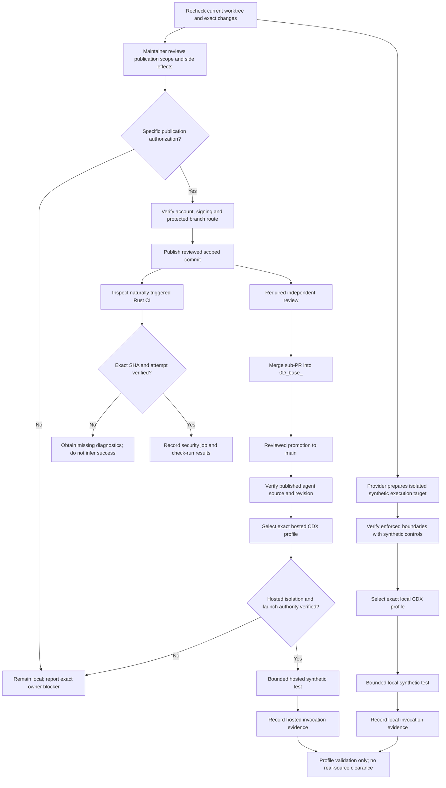
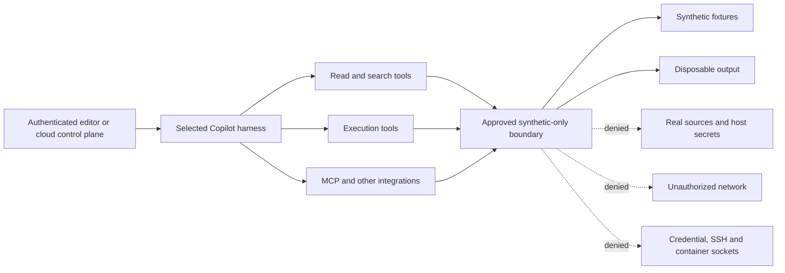
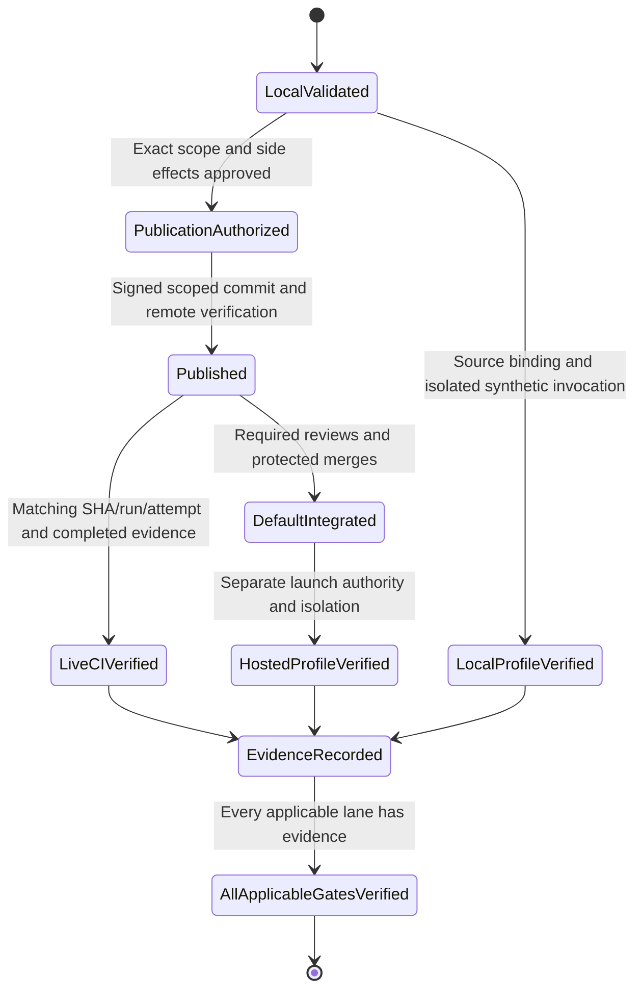

# CDX maintainer/provider execution guide

## 1. Purpose and current boundary

This guide explains how to resolve:

1. Maintainer authorization for publication and execution.
2. Live CI verification of the local Rust/security-audit changes.
3. Actual CDX profile selection and credential-free execution isolation.

The [continuation](./CONTINUATION.md) remains authoritative. The
[human-only plan](./human_continuation_plan.md) identifies responsible owners.
This guide includes Copilot's follow-through without moving routine CLI work
into the human-only plan.

**These instructions are procedures, not evidence that an action succeeded.**
Commands below were not executed as part of creating this guide. Earlier
conversation responses supplied the guide text but did not save a file.

The latest recorded implementation task authorized **local work only**. Older
statements about broader approval must not be treated as authorization to
publish these newer changes. Reuse an existing approval only when it actually
covers the same operation and exact scope.

### Important researched limitation

The continuation records an Alpine/musl environment. The official VS Code
documentation consulted for the preceding response states that sandboxed shell
execution is unsupported on Alpine and other musl-based distributions.
Recheck the installed runtime and current official documentation before acting.

Therefore:

- Verify the current execution host.
- Do not assume installing `bubblewrap` fixes an unsupported runtime.
- If the host remains musl-based, a provider must supply a supported execution
  target or another demonstrably equivalent containment mechanism.
- Ordinary local validation can continue separately; it does not prove
  isolation.

## 2. Dependency map



## 3. Maintainer authorization and publication

### 3.1 Copilot: establish fresh state

In the existing VS Code window:

1. Select **Terminal > New Terminal**.
2. Confirm the terminal belongs to the intended remote workspace.
3. Run:

```bash
cd /workspaces/_codex_

git branch --show-current
git rev-parse HEAD
git status --short --branch
git diff --cached --stat
git diff --stat
git diff --check

git --no-pager diff -- \
  .github/workflows/rust_swarm_ci.yml \
  .vscode/tasks.json \
  Cargo.lock \
  site/plans/cdx_archive_scanner_preflight_recovery/CONTINUATION.md

gh --version
gh auth status
gh repo view Aries-Serpent/_codex_ \
  --json nameWithOwner,defaultBranchRef
```

**Expected:** actual branch/SHA, identifiable scoped changes, and
account/repository access results. Do not dump environment variables, tokens or
credential files. Authentication status does not establish authorization for
every repository operation.

Do not reset, stash, clean, rebase or overwrite existing work.

### 3.2 Maintainer: approve the exact operation

Review the actual diff, not only the previous summary. A useful authorization
statement is:

> I authorize publication of the reviewed scoped changes on the verified
> session branch and creation or update of its sub-PR against `0D_base_`. I
> acknowledge the identified workflows and side effects of the push. This does
> not authorize merges, unrelated workflow dispatches/retries, settings changes,
> hosted-agent launches or real-source archive operations.

If hosted invocation is also wanted, authorize it **separately**, identifying
the target, synthetic scope and permitted platform side effects.

Do not repeatedly request generic consent when an existing approval clearly
covers the same operation and exact scope.

### 3.3 Copilot: inspect push side effects before publication

The Rust workflow is not the only workflow a push may trigger.

Before pushing:

1. Inspect applicable push-triggered workflows.
2. Identify deployment, package publication, automation and concurrency effects.
3. Verify the push will not retry or recreate the prohibited timed-out CodeQL
   operation.
4. If that cannot be established, stop before pushing and request an approved
   publication route.

Do not disable security controls or change workflow settings merely to make
publication possible.

### 3.4 Account/signing owner: intervene only on an actual failure

**VS Code account repair:**

1. Click the **Accounts** icon.
2. Select the applicable GitHub sign-in or account-management action.
3. Complete authentication in the trusted browser.
4. Complete organization SSO if required.
5. Return only a redacted success/failure confirmation.

**Signing repair:**

Copilot first inspects configuration without reading private keys:

```bash
git config --show-origin --get commit.gpgsign
git config --show-origin --get gpg.format
```

An unset value is an observation, not proof that a signer is available.
If signing fails, the signing owner restores the genuine configured signer or
performs the authorized signed operation with their own identity. Do not
disable signing or impersonate another signer.

**Repository administrator intervention, only after a demonstrated denial:**

1. Open the repository's **Settings** using an authorized administrator account.
2. Inspect the applicable **Collaborators and teams**, **Rules/Rulesets**,
   **Actions**, or installed GitHub App control implicated by the denial.
   Organization-managed controls may require the organization owner.
3. Grant only the needed operation or repair the demonstrated restriction;
   preserve required checks, reviews and branch protections.
4. Return the non-sensitive control reference and permitted operation.
5. Copilot verifies the operation through its supported interface.

Do not grant blanket administration or expose a token to solve a narrow denial.
There is no standing requirement to change repository workflow-token defaults:
the prepared audit fix requests job-level permissions.

### 3.5 Copilot: publish only after the preceding gates

Recheck supported options:

```bash
gh pr create --help
gh pr checks --help
```

Before staging:

- Review every intended file, including this guide if publication includes it.
- Exclude unrelated existing edits.
- Use interactive staging where a file contains mixed ownership.
- Inspect the [repository PR template](../../../.github/pull_request_template.md)
  and any applicable template directory; preserve its structure and applicable
  maintainer checklist selections.
- Reuse a matching open PR rather than creating duplicates.

In the following examples, `BRANCH`, `BODY_FILE`, `RUN_ID`, `ATTEMPT` and other
uppercase variables are placeholders to assign from verified evidence, not
literal values to copy blindly.

Conditional publication commands:

```bash
set -e
# Stage only the reviewed, authorized content first.
git diff --cached --check
git --no-pager diff --cached

git commit -S \
  -m "Validate CDX tasks and remediate Rust audit integration" \
  -m "Co-authored-by: Copilot <223556219+Copilot@users.noreply.github.com>"

git verify-commit HEAD
git rev-parse HEAD

# BRANCH must be the freshly verified, authorized branch.
: "${BRANCH:?Verified authorized branch required}"
git push origin "HEAD:refs/heads/$BRANCH"

# BODY_FILE must follow the repository PR template.
: "${BODY_FILE:?Reviewed template-conformant PR body required}"
gh pr create \
  --repo Aries-Serpent/_codex_ \
  --base 0D_base_ \
  --head "$BRANCH" \
  --title "Validate CDX tasks and remediate Rust audit integration" \
  --body-file "$BODY_FILE"
```

A successful push proves publication, not required review, mergeability or live
CI success.

### 3.6 Required reviewers and integration maintainer

1. Open the scoped sub-PR and verify **base: `0D_base_`** and the exact head SHA.
2. Open **Files changed** and review the current diff.
3. The required independent reviewer uses **Review changes** and records their
   actual decision. The implementer must not manufacture independent approval.
4. Inspect required checks and unresolved review threads.
5. Only an authorized merger uses the repository-approved merge action after
   protections and reviews are satisfied; do not bypass controls.
6. Record the resulting `0D_base_` SHA.
7. Create or reuse the reviewed promotion PR from `0D_base_` to `main`.
8. Repeat required review/check/merge controls for that promotion.
9. Copilot reads back the actual default-branch SHA and profile bytes.

If the head changes after review, reconcile review/check freshness before
merging. An open PR is not default-branch integration.

## 4. Live CI confirmation

### 4.1 Understand the actual Rust trigger

The inspected [Rust workflow](../../../.github/workflows/rust_swarm_ci.yml) has:

- Push triggers for `main`, `develop` and `copilot/**`.
- Pull-request triggers targeting `main`.
- Markdown/documentation exclusions.
- **No `workflow_dispatch` event.**

Consequences:

- An authorized push containing the Rust lockfile/workflow changes to the
  session branch is an applicable trigger.
- Merely opening the sub-PR against `0D_base_` does not match its PR trigger.
- Do not instruct a maintainer to click a nonexistent **Run workflow** button.
- Do not add a dispatch event solely to get a green run.
- Reinspect current workflow bytes before relying on these recorded triggers.

### 4.2 Browser: inspect the correct run

1. Open the repository on GitHub.
2. Click **Actions**.
3. Select **Rust-Python Hybrid Swarm CI/CD**.
4. Locate the run associated with the newly published commit.
5. Open the run.
6. Confirm the commit SHA and triggering event.
7. Identify the attempt number.
8. Click **Security Audit**.
9. Inspect **Run cargo audit** and **Run cargo deny (if available)**.
10. Follow associated check details to verify check-run creation.

Do not click **Re-run all jobs** or **Re-run failed jobs** without specific
authorization.

### 4.3 Copilot: bind evidence using CLI/API

```bash
REPO=Aries-Serpent/_codex_
TARGET_SHA="$(git rev-parse HEAD)"

gh run list --repo "$REPO" \
  --workflow rust_swarm_ci.yml \
  --commit "$TARGET_SHA" \
  --limit 10 \
  --json databaseId,attempt,event,headSha,status,conclusion,url
```

After choosing the matching run and attempt:

```bash
: "${RUN_ID:?Matching run ID required}"
: "${ATTEMPT:?Verified run attempt required}"

gh run view "$RUN_ID" --repo "$REPO" \
  --attempt "$ATTEMPT" \
  --json databaseId,attempt,event,headSha,workflowName,status,conclusion,jobs,url

gh api --paginate \
  "repos/$REPO/actions/runs/$RUN_ID/attempts/$ATTEMPT/jobs?per_page=100"

gh api --paginate \
  "repos/$REPO/commits/$TARGET_SHA/check-runs?per_page=100"
```

Check-runs must also be correlated with the selected job/run through their
available IDs and links. SHA matching alone does not prove the correct attempt.
No matching run means pending/unavailable evidence, not success.

### 4.4 Acceptance criteria

| Claim | Required evidence |
| --- | --- |
| Authentication fix works | The patched revision successfully creates the expected check run; no GitHub App authentication failure |
| Advisory remediation works in CI | Audit and cargo-deny complete successfully for the patched revision |
| Security job passes | `Security Audit` is completed with conclusion `success` |
| Entire workflow passes | Every required job and the workflow conclusion are independently verified |
| Fork behavior works | A separately authorized representative fork-event test; same-repository push evidence is insufficient |

`queued`, `in_progress`, `skipped`, `cancelled`, `neutral` and `unavailable` are
not success.

### 4.5 Failed-run handling

Copilot retrieves diagnostics only into an approved private diagnostic
location. A directory name or `chmod` alone does not establish approved custody.

```bash
: "${PRIVATE_DIAGNOSTICS:?Approved private diagnostic location required}"

gh run view "$RUN_ID" --repo "$REPO" \
  --attempt "$ATTEMPT" \
  --log-failed \
  > "$PRIVATE_DIAGNOSTICS/failed-steps.log"
```

Do not paste raw logs or secrets into public documentation.

If access is denied:

1. Record the failing operation and redacted error.
2. The administrator identifies the specific missing Actions/checks read
   permission or supplies approved diagnostics.
3. Copilot repeats the read and verifies the result.
4. Runner/provider faults go to the runner/provider owner.

Never retry or recreate the prohibited CodeQL operation.

## 5. Verify execution isolation before profile invocation

### 5.1 Distinguish the boundaries



Editor login is not the same as credentials exposed to agent tools.
Authentication may exist in the control plane while execution remains
credential-free, but the provider must demonstrate that separation.

A container, separate Git worktree, instruction file or approval dialog alone
does not establish it.

### 5.2 Provider: supply the execution target

First inspect the actual host:

```bash
uname -s
uname -m
cat /etc/os-release
```

If still Alpine/musl:

1. Keep the current workspace and dirty changes intact.
2. Provision an approved supported glibc-based remote environment or another
   verified containment target.
3. Do not rebuild the current workspace automatically.
4. Supply only reviewed profile/tool code and synthetic fixtures.
5. Exclude real sources, repository credentials, SSH agents, credential helpers
   and host/container control sockets.

This must cover all effective tools, not just one terminal command.
Do not transfer private source material to an external provider without its
separate data-handling authorization.

### 5.3 Supported VS Code sandbox: click-by-click

On a supported execution host:

1. Open **Settings** with `Ctrl+,`.
2. Select the settings scope for the actual remote execution host.
3. Search for `chat.agent.sandbox.enabled`.
4. Set it to `on`.
5. Disable execution-network access.
6. Disable injected Git and GitHub CLI credentials.
7. Disable unsandboxed-command bypass.
8. Restrict filesystem access to approved synthetic inputs and disposable
   outputs.
9. Start a new Copilot harness session.
10. Submit `/sandbox policy`, if supported.
11. Review the effective policy, not only saved settings.

Illustrative settings to verify against the installed runtime:

```json
{
  "chat.agent.sandbox.enabled": "on",
  "chat.agent.sandbox.network.allowNetwork": false,
  "chat.agent.sandbox.network.allowLocalNetwork": false,
  "chat.agent.sandbox.credentials.authenticategit": false,
  "chat.agent.sandbox.credentials.authenticategh": false,
  "chat.agent.sandbox.fileSystem.allowDevToolAccess": false,
  "chat.agent.sandbox.allowUnsandboxedCommands": false
}
```

These settings do not remove pre-existing environment secrets, constrain
independently started servers or prove every tool is contained. Provider
provisioning and actual verification remain necessary. The current working
directory may receive default read/write grants; use a synthetic-only workspace,
not the real repository, for this isolated test.

### 5.4 Adversarial verification

Use only provider-created synthetic canaries, never real credential files.
The provider defines exact harmless probe paths/endpoints before execution.

| Test | Expected outcome |
| --- | --- |
| Read approved synthetic fixture | Allowed |
| Write disposable test output | Allowed |
| Read synthetic canary outside allowed boundary | Denied through every applicable tool |
| Write outside approved output boundary | Denied |
| Follow symlink to outside synthetic canary | Denied |
| Access unapproved provider-controlled network test endpoint | Denied |
| Use credential or control sockets | Absent or denied |
| Escape to unsandboxed execution | Denied |
| Change source snapshot during the operation | Prevented or detected and rejected |

Record exit statuses and redacted results. A failed network request alone is
not sufficient: establish that the provider's test endpoint was reachable from
its control context and the selected runtime denied access.

An unexpected allowed operation blocks invocation until its owning control is
fixed. Do not enumerate host secrets or real sockets to test the boundary.

## 6. Select and test the local CDX profile

### 6.1 Copilot: verify source/catalog

In the existing repository, separately from the isolated execution target:

```bash
cd /workspaces/_codex_

sha256sum .github/agents/cdx-archive-lifecycle.agent.md

.venv/bin/python \
  -m scripts.ci.startup_health --validate
```

The [profile](../../../.github/agents/cdx-archive-lifecycle.agent.md) display name
is **CDX Archive Lifecycle**; its catalog ID is `cdx-archive-lifecycle`. Neither
identifier alone proves selection. Verify that the approved target's supplied
profile bytes match the reviewed source; hashes bind bytes, not authority.

### 6.2 VS Code operator: click-by-click

In the verified isolated target:

1. Open the approved synthetic workspace.
2. Press `Ctrl+Shift+P`.
3. Run **Chat: Open Customizations**.
4. Select **Agents**.
5. Locate **CDX Archive Lifecycle**.
6. Open or inspect its source location.
7. Confirm it is the reviewed repository profile supplied through the approved
   target provisioning, not an unrelated user, extension or duplicate profile.
8. Start a new chat.
9. Choose the intended **Copilot harness / Session Target**.
10. Select **CDX Archive Lifecycle** in the agent dropdown.
11. Inspect effective tools.
12. Confirm the sandbox policy and credential-free boundary.
13. Submit the bounded prompt below.

If the profile is missing or its source cannot be verified, stop and report that
exact selection problem. Do not substitute the default agent. UI labels can
change; use the installed provider's supported equivalent and record it.

### 6.3 Bounded synthetic prompt

> Perform a synthetic CDX profile smoke test only. First establish the actual
> selected profile source/revision, harness, effective tools and verified
> isolation. If unavailable, report the missing evidence and stop. Read only the
> approved synthetic fixtures and profile/tool metadata. Exercise the maintained
> read-only CDX context entrypoint. Report commands, outputs and boundaries
> without sensitive data. Do not acquire or scan real sources, create
> epochs/queues/checkpoints, approve findings, pack/extract archives,
> authenticate, publish changes, dispatch workflows or launch additional agents.

Success requires a completed invocation record, provider-verifiable source
binding, isolation evidence, actual tool results and no unauthorized side
effects. Agent self-identification or a screenshot alone is not proof.

## 7. Hosted profile selection and invocation

### 7.1 Prerequisites

Before launch:

1. Required reviewers complete genuine reviews.
2. The sub-PR lands in `0D_base_`.
3. The reviewed promotion lands in the actual default branch.
4. Copilot verifies the published profile bytes and commit.
5. The provider demonstrates hosted tool isolation separately from local
   isolation.
6. A maintainer authorizes the specific launch and any automatic PR/branch
   effects.

If the hosted service exposes repository credentials to execution, it does not
satisfy a credential-free execution requirement merely because it is managed.

### 7.2 GitHub UI: click-by-click

Only after prerequisites:

1. Open the repository.
2. Open **Agents**, or the supported Copilot task-launch surface.
3. Set the working repository, not merely an attached repository reference.
4. Choose the intended execution target and reviewed base revision.
5. Select **CDX Archive Lifecycle** from the custom-agent selector.
6. Verify its published source/revision.
7. Inspect permissions and isolation evidence.
8. Use manual/always-ask approval where available; do not select blanket
   **Allow all**.
9. Submit the bounded synthetic prompt.
10. Record the task reference, selected profile, revision and completed result.
11. Inspect any automatically created branch/PR without merging it.

If the UI lacks a verifiable selector or isolation evidence, return that exact
provider blocker. Entitlement or organizational policy repair belongs to the
account/organization administrator; do not change subscriptions or policies
without that owner's authorization.

### 7.3 CLI alternative: verify support first

```bash
gh --version
gh agent-task create --help
gh agent-task view --help
```

The official documentation consulted for the preceding response identifies
`agent-task` as available in GitHub CLI 2.80.0 and later, in public preview.
Verify the installed interface rather than assuming historical options.

The continuation's `--custom-agent` and `--from-file` examples must be checked
against installed help. Do not assume support or silently omit custom-agent
selection.

A hosted launch may automatically open a PR. It is not a read-only probe and
must not be used if its generated base/publication behavior violates the
required route.

## 8. Completion and owner handback



The lanes above can progress independently. Recording evidence for one lane
does not complete the others.

Return this evidence for each resolved item:

| Field | Required content |
| --- | --- |
| Owner/action | Who repaired or authorized which operation |
| Scope | Repository, branch, revision and synthetic target |
| Reference | Non-sensitive review, control, run or invocation reference |
| Result | Success, failure, unavailable or still pending |
| Limits | What was not tested or authorized |
| Next executor | Copilot, maintainer, administrator or provider |

Update the continuation only after verification. Keep private endpoints,
credentials, raw findings and source bytes out of this guide and public chat.

These resolutions do not establish S/D/R/P/C/E/F/A/G, independent finding
approval or real-source/archive clearance. Those remain separate gates.

## Official references

- [VS Code custom agents](https://code.visualstudio.com/docs/agent-customization/custom-agents)
- [VS Code agent sandboxing and platform support](https://code.visualstudio.com/docs/agents/run/agent-sandboxing)
- [GitHub custom agents](https://docs.github.com/en/copilot/how-tos/copilot-on-github/customize-copilot/customize-cloud-agent/create-custom-agents)
- [GitHub cloud-agent CLI](https://docs.github.com/en/copilot/how-tos/use-copilot-agents/cloud-agent/use-cloud-agent-from-cli)
- [GitHub CLI run list](https://cli.github.com/manual/gh_run_list)
- [GitHub CLI run view](https://cli.github.com/manual/gh_run_view)
